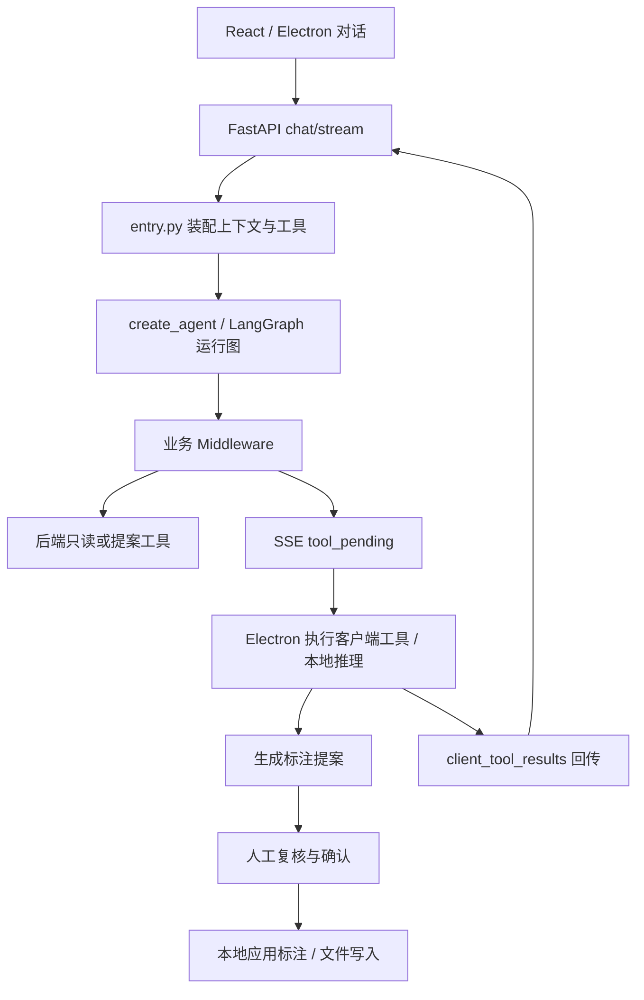

# LR-Agent 项目与历史会话分析

分析日期：2026-10-17。对象为 `D:\Study\LR-Agent` 当前工作区，以及下列四个历史会话的相关轮次。本文区分本轮实测、源码事实、历史记录和后续建议；历史会话中的授权不作为本轮执行修改、清理或推送的授权。

## 一、项目定位与当前阶段

这是一个以 Electron/React 为交互入口、Python Agent 为编排核心、YOLO 等本地模型为执行工具的智能标注平台。对你而言，它首先是一套 Agent 学习与实践环境，其次才是产品完善和求职项目素材。

> 范围更新：用户已明确本项目不需要 RAG。下文涉及 RAG 的历史会话仅用于还原背景，不构成开发计划。本文为首次只读分析快照；后续已统一正式依赖并将追踪改为可选。部署与验证结论以更新后的《本地部署方案》及《2026-10-17本地主流程验收记录》为准。

你此前明确纠正过学习方向：以飞书课程为主线，用已部署项目验证概念；重点是 Python、LangChain、工具调用和上下文机制，前端主要理解调用链，认证后端用于理解配套服务。YOLO/SAM 是真实业务工具，不应取代 Agent 学习主线。这一原则也写入了[智能体自学阶段规划](D:/Study/LR-Agent/docs/智能体自学阶段规划.md)。

当前状态已经超过“部署完成、开始学习”的阶段：

- 统一根仓库为 `boshilin123/LabelAgent`，当前分支为 `main`，提交 `2828125`。
- 本地 `HEAD` 与本地缓存的 `origin/main` 相同。本轮没有 fetch，不能据此判断 GitHub 此刻是否出现新提交。
- 默认 Agent 已由自研循环迁移为官方 `create_agent`，保留 `legacy` 路径回退。
- LangSmith 追踪已接入启动脚本；Studio 已有独立的只读调试入口。
- 尚无完整的文档向量检索/RAG 链路；课程讨论和改造计划不能算成已实现功能。
- `study/` 当前没有文件，实际学习资料集中在 `docs/`，部分仍未纳入 Git。

## 二、历史会话之间如何衔接

### 1. 开源自动标注Agent：部署与学习目标确立

[打开会话](codex://threads/01a0ad18-000e-7292-828c-c4a7eb0fbd0d)

这一阶段主要解决 Windows 部署、Docker 配套服务、Python 推理环境、DeepSeek Tool Calling、阈值和标签映射、目录整理与个人仓库迁移。最重要的长期决定是：课程决定学习顺序，项目提供运行案例；新增学习文档使用中文名称；统一在根目录提交到个人 LabelAgent 仓库。

会话早期给出的“先继续优化标注效果”的建议，后来被你明确纠正为“优先学习 Agent”。因此不能将早期功能优化清单继续当作你的当前首要任务。

### 2. 项目学习--RAG及其后续：厘清概念

[打开会话](codex://threads/01a0c2ac-253d-73c1-a777-4e0b91aadb72)

这一阶段进入课程第 4 章 Agentic RAG，讨论了 Loader、Splitter、Embedding、VectorStore、Retriever 和检索工具的关系，并明确：

- `grep_workspace` 是关键词搜索。
- `memory_read` 是读取记忆文件。
- 这两者都不能单独证明项目已经具有语义检索知识库。
- 将 Retriever 注册为工具，并由 Agent 决定何时调用，才形成这里讨论的 Agentic RAG。

当时“没有 LangGraph、只有 LangChain 基础组件和自研 Tool Loop”的结论适用于旧代码，今天已不适用于默认引擎。该会话引用的 `01a0b35c-7fba-7f72-815f-cbd26adae494` 本轮未能读取，因此不声称覆盖该会话的完整学习记录。

### 3. 简历编写：从岗位表述延伸到架构迁移与调试

[打开会话](codex://threads/01a0cccf-102a-7491-b8fa-fea29767c8cf)

这个标题下发生的不只是简历写作，还包括新版代码切回原目录、迁移副本清理、LangSmith 追踪与 Studio 图调试接入。

历史顺序是：隔离副本迁移和验收 → 迁移代码提交到个人仓库 → 原目录切换到新版 `main` → 清理独立迁移副本 → 在原启动命令中接入追踪 → 增加 Studio 只读图入口。

所以旧文档里频繁出现的 `D:\Study\LR-Agent-LangChain-Migration` 是历史执行位置。当前继续学习和修改应以 `D:\Study\LR-Agent` 为准。

### 4. 简历编写--自动标注：形成产品表达，但量化证据不足

[打开会话](codex://threads/01a0d23d-aafb-7732-b78c-89e4f8d3f850)

你希望表述先交代标注场景和产品能力，再用工程机制解释个人贡献；技术名词要对应真实实现，而不是只写“基于 LangChain”。会话最后还修正了一个重要概念：MCP 是协议，通过 MCP Server 发现并适配后的能力才是 Agent 可调用工具；Middleware 负责执行控制，不能混写成 MCP 本身。

“1000 张图片、耗时降低 67.5%”在所读会话中来自简历截图，未附独立的同口径计时记录。本轮查看的验收文档也不足以证明该指标。它应标记为待核实，不能当成代码测试已经证明的结果。

同样，开源平台现成功能、你实际完成的改造、拟放进 BAMS 经历的内容，需要分别核实个人参与证据。项目代码存在某功能，不自动证明该功能由你独立实现。

## 三、当前架构：最值得掌握的是跨进程工具执行

### 组件职责

- `LR-Agent/src/renderer`：React 对话、标注画布、SSE 消费、提案展示、客户端任务执行与结果回传。
- `LR-Agent/src/main`：Electron 本地资源宿主，包括文件系统、SQLite、Markdown Memory、MCP、推理进程和 IPC。
- `LR-Agent/vendor/local-agent`：FastAPI + LangChain，负责理解指令、模型/工具循环、工具装配、门禁、续跑及 SSE 适配。
- `LR-Agent/vendor/inference`：YOLO/SAM 等模型推理，与纯编排环境分离。
- `LR-Agent-backend`：认证、用户资料及配套服务；Docker Compose 提供 API、PostgreSQL、Redis、MinIO。它不是当前本地 Agent 对话状态的持久化中心。

### 默认执行链路



这条链路的价值在于：模型负责决定调用什么，服务端控制调用是否允许，客户端执行需要本地资源的操作，人工确认决定提案是否应用。工具完成推理、产生提案、确认写盘是不同状态。

### 关键源码阅读入口

1. [路由与引擎选择](D:/Study/LR-Agent/LR-Agent/vendor/local-agent/app/api/v1/agent.py:510)：区分 `legacy` 和 `candidate`。
2. [工具与上下文装配](D:/Study/LR-Agent/LR-Agent/vendor/local-agent/app/agent/langchain_runtime/entry.py:334)：内置工具、MCP 发现、权限过滤与模型构建。
3. [官方 Agent 构建](D:/Study/LR-Agent/LR-Agent/vendor/local-agent/app/agent/langchain_runtime/runtime.py:146)：实际调用 `create_agent`。
4. [业务 Middleware](D:/Study/LR-Agent/LR-Agent/vendor/local-agent/app/agent/langchain_runtime/middleware.py:150)：阶段门禁、调用合批/去重、客户端工具延后执行与预算收尾。
5. [跨请求续跑](D:/Study/LR-Agent/LR-Agent/vendor/local-agent/app/agent/langchain_runtime/resume.py:1)：补齐 ToolMessage、已完成调用 ID 和重复投递处理。
6. [SSE 适配](D:/Study/LR-Agent/LR-Agent/vendor/local-agent/app/agent/langchain_runtime/sse_adapter.py)：将框架事件转换为桌面端既有协议。
7. [客户端执行循环](D:/Study/LR-Agent/LR-Agent/src/renderer/services/agentJobRegistry.ts:768)：消费挂起事件、执行客户端工具并续跑。
8. [提案应用](D:/Study/LR-Agent/LR-Agent/src/renderer/services/agentProposalApply.ts)：审核之后的应用行为。

### 容易混淆的四个边界

**LangGraph 已使用，但没有自行编写业务 StateGraph。** 当前环境实际安装 `langchain==1.4.2`、`langchain-core==1.6.4`、`langgraph==1.2.12`；`create_agent` 返回运行图。业务阶段主要仍由 Middleware 和请求上下文表达。

**跨请求续跑不等于持久化 checkpoint。** `resume.py` 明确没有 checkpointer 或 `interrupt()`：服务端依靠请求携带的消息、上下文和客户端工具结果重建执行。不能据此宣称已经具备数据库持久化的工作流恢复能力。

**Studio 不是完整桌面标注流程。** `studio_graph.py` 复用真实构建器，但采用只读工具集；未配置专用模型凭据时可展示图结构，不能执行真实模型对话。自动标注、Electron 人工确认和落盘流程没有因此自动接入 Studio。

**数据库与 Memory 不等于 RAG。** PostgreSQL 用于认证后端，SQLite 用于桌面会话/配置，Markdown 文件承载 Memory；本轮在核心执行代码中未发现完整 Embedding → VectorStore → Retriever 链路。

## 四、本轮验证与历史验收的区别

### 本轮实测

在 `.venvs\langchain-main` 环境执行：

```powershell
# 工作目录：D:\Study\LR-Agent\LR-Agent\vendor\local-agent
& 'D:\Study\LR-Agent\.venvs\langchain-main\Scripts\python.exe' -B -m pytest -q -p no:cacheprovider
& 'D:\Study\LR-Agent\.venvs\langchain-main\Scripts\python.exe' -B -m experiments.compare_agent_contract
```

- Local Agent：**568 passed, 2 skipped**，耗时约 12.67 秒。
- 一个警告：`pytest.mark.integration` 未注册。
- 对照 harness：**16/16 场景逐帧一致**，含 HTTP/SSE 层。
- harness 测试指纹：53 文件 / `D6A6746236F59359`。
- 实际默认设置为 `candidate`，启动脚本也显式设置 `AGENT_ENGINE=candidate`。

与历史 `566 passed` 相比，本轮包含额外两项 Studio 测试。测试通过证明相应自动化契约成立，不代表真实模型准确率、人工标注效率或完整 GUI 流程已经验收。

### 历史记录能够证明什么

[阶段6与8验收](D:/Study/LR-Agent/docs/阶段6与8-真实模型与端到端验收.md)记录了真实模型调用、真实推理协议、长会话只读调用和渲染层协议对照，但最终边界仍写明：真实 Electron GUI 全链路和确认后的实际磁盘写入未在该次迁移验收中完成。

[桌面端诊断记录](D:/Study/LR-Agent/docs/副本桌面端启动与验收记录.md:30)还记录了两个很有学习价值的真实问题：保存的 `0.3` 阈值被 `undefined` 覆盖后，推理退回默认 `0.7`；模型类别名与项目标签名不一致导致映射失败。修复后对 22 张图片只读推理，19 张有框、共 22 框。这个结果没有人工真值，不能换算成准确率或召回率。

本轮没有启动桌面程序、调用真实付费模型、重新测量 YOLO、检查当前容器健康或复跑前端全部测试，因此不把历史的“当前运行正常”延用为今天的运行状态。

## 五、工程问题与建议优先级

### 优先处理：安装入口与默认引擎不一致

证据：[requirements.txt](D:/Study/LR-Agent/LR-Agent/vendor/local-agent/requirements.txt:8)仍固定 `langchain-core==1.4.0` 且没有 `langchain/langgraph`；[默认设置](D:/Study/LR-Agent/LR-Agent/vendor/local-agent/app/core/config.py:56)却已选择 `candidate`；[README](D:/Study/LR-Agent/LR-Agent/vendor/local-agent/README.md:30)仍指导安装前者。

影响：现有 `.venvs\langchain-main` 能运行，但新机器按 README 安装后，默认对话路径缺少候选运行时依赖；健康检查成功也未必暴露该问题。

建议统一正式依赖清单、环境创建命令和默认引擎说明，再从干净环境验证一次安装。不要通过“已有本机环境能跑”来代替可复现部署。

### 随后处理：基础启动强依赖 LangSmith 凭据

[启动脚本](D:/Study/LR-Agent/scripts/start-lr-agent.ps1:25)在本机 Key 文件缺失或格式不符时直接抛错，然后才启动应用。此前你明确要求接入追踪，因此这不是擅自增加的功能；但它使可观测性配置成为启动前提。

建议将追踪设为可配置项：有有效 Key 时启用；没有时仍允许运行核心 Agent。若你有意要求始终追踪，则至少在启动文档中明确这一前提。

### 维护成本：文档与仓库状态漂移

[Agent与LangChain实现分析](D:/Study/LR-Agent/docs/Agent与LangChain实现分析.md)开头仍描述旧架构，包含“没有 LangGraph”“没有 create_agent”“没有 LangSmith”等结论。迁移文档则保留多个“后续状态覆盖前文”的更新块，阅读时容易错把旧限制当成当前事实。

Git 当前已有 `.gitignore`、启动脚本的本地修改，以及多份未跟踪学习笔记、Studio 文件、实验目录和 `.langgraph_api/`。远端分支相同不意味着这些本地内容已被备份。

建议保留历史验收记录，同时另设一份简短的“当前架构与启动入口”；将应保存的代码和中文笔记与运行缓存分开确认后提交。不要把未跟踪内容一概视为可清理文件。

### 业务证据：真实闭环与量化指标仍需补齐

优先补一个可复核的 GUI 验收：选定测试图片 → 自然语言发起 → 参数与标签映射核对 → 提案复核 → 确认应用 → 核查标注文件 → 重启后核查结果。

若要量化简历成果，再分别做：

- 检测质量：人工真值、Precision/Recall/mAP 等明确口径。
- 人工效率：同等质量标准下，纯人工与“预标注＋复核修正”的耗时对照。
- 工程兼容：继续用 16 场景协议对照和回归测试表达。

三类证据不能相互替代。

## 六、最适合你的下一步

先做一次“课程概念 → 当前代码 → 小实验 → 中文笔记”的完整学习闭环，比继续添加框架名词更有收益。

1. **先对齐当前运行链路。** 从路由、entry、runtime、middleware、SSE、客户端执行到提案应用，追踪一次 `auto_annotate`，记录每步输入/输出、执行进程和状态变化。
2. **集中理解 State / Context / Store。** 对照请求上下文、图内消息状态、SQLite/Markdown 持久化，解释为什么当前 resume 不等于 checkpoint。
3. **用现有追踪辅助阅读。** LangSmith 看单次请求中的模型/工具轨迹；Studio 看真实只读 Agent 图。跨请求与客户端内部步骤需要单独关联，不能只看一条 Python trace 就认为看到了完整任务。
4. **补齐主流程验收。** 在独立测试项目中核对模型参数、工具执行、候选提案、人工确认与实际文件回读。本项目不新增 RAG、向量知识库或相关依赖。
5. **最后补求职证据。** 整理个人改造的提交、典型问题修复、实验笔记与可复现度量，再确定简历中的个人贡献和数字。

本轮仅新增分析材料，未修改业务源码、启动配置或已有文档，也未提交、推送或清理已有文件。
