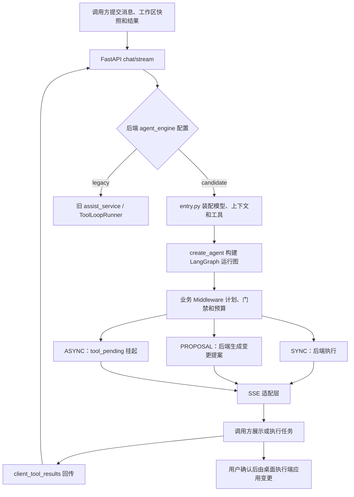

# 2026-10-28 项目与后端 Agent 分析

分析对象：`D:\Study\LR-Agent`。分析起点为 `main` 的 `d5dd009`，并包含工作区已有的学习文档、注释修订与日志修复。已执行 `git fetch origin`；分析时 `HEAD...origin/main` 为 `0 / 0`。本文以当前源码和本次离线实测为事实依据，历史验收单独标注。

## 1. 项目定位与阅读范围

项目是本地智能标注桌面应用：大模型负责判断和编排，工具负责读取工作区、组织标注任务或生成文件提案，独立推理进程运行 YOLO/SAM 等模型，用户确认后由桌面执行端应用变更。

后端应分成三个职责理解：

- `LR-Agent/vendor/local-agent`：本次重点。FastAPI 接收请求，LangChain / LangGraph 承担 Agent 循环，业务代码管理工具策略、SSE、续跑和视觉适配。
- `LR-Agent/vendor/inference`：模型推理进程。`server.py::main` 读取 stdin JSON Lines，按 `ping/run/shutdown` 分派，向 stdout 输出 JSON。它不是另一套 FastAPI Agent，也不负责会话记忆。
- `LR-Agent-backend`：认证和用户资料 API，配套 PostgreSQL、Redis、MinIO。不能把这个目录误当成当前 Agent 核心，也不能把 PostgreSQL 当作当前 Agent 的图状态存储。

前端仅用于确认调用协议、执行主体和人工确认边界。本次没有调用云模型、运行真实 YOLO、变更标注数据或改造 Agent 业务逻辑。

## 2. 当前默认调用链

默认配置是 `app/core/config.py::Settings.agent_engine = "candidate"`，正式环境为 `.venvs/langchain-main`，安装入口为 `vendor/local-agent/requirements.txt`。`candidate` 是迁移期沿用的名字，当前已承担默认路径；`legacy` 保留为回退和对照路径。



主要源码入口（均相对 `LR-Agent/vendor/local-agent`）：

1. `local_main.py::create_app`：挂载本地 token 依赖与路由；脚本入口默认监听 `127.0.0.1:8765`。`/health` 仅证明进程可响应。
2. `app/api/v1/agent.py::local_chat_stream`：按后端配置选择引擎，判定之后才导入 candidate，维持 legacy 的依赖隔离。
3. `app/agent/langchain_runtime/entry.py::stream_candidate_engine_sse`：构造模型对、系统提示、工具集、MCP 发现、阶段上下文与运行输入，驱动流，负责最终 `done` 和取消注册清理。
4. `entry.py::build_engine_agent`：装配业务 middleware、视觉 middleware，以及只读查阅子代理；续跑时先补消息和已完成 ID。
5. `runtime.py::build_langchain_agent`：薄封装 `create_agent`，注入模型、工具、上下文 Schema 和 middleware；没有传入 checkpointer 或 Store。
6. `sse_adapter.py::stream_agent_events`：把官方流事件映射为项目事件，处理轮末工具、提案与子代理进度。它不负责最终 `done`。

没有工作区或项目快照时，candidate 入口会走 `chat_service.stream_chat`，不构建带工具的运行图。因此普通聊天通过，不能证明 Agent 工具链通过。

## 3. Agent 中最值得学习的机制

### 3.1 工具 Schema 与执行主体分离

`tools/registry.py` 构造 `StructuredTool`，`tools/tool_registry_meta.py` 给出工具执行分类的单一来源。模型只能提出调用，业务层决定能否执行、在哪里执行。

- `SYNC`：本次后端调用中完成，如 `read_workspace_file`、`grep_workspace`、`read_file_annotation`。名字中的同步表示完成位置，不意味着实现必须使用 Python `def`；MCP 适配工具也可能用异步协程执行。
- `PROPOSAL`：例如 `write_workspace_file`、`str_replace_workspace_file`、`delete_workspace_file`、`move_workspace_file`。后端校验并发送提案，文件变更由 Electron 确认应用。
- `ASYNC`：`auto_annotate`、`mutate_annotation`、`start_terminal_command`。后端发挂起事件，桌面执行端完成任务，再回传结果；后端不应运行这些工具占位实现。

三类 runner 是业务执行策略，不能直接等同于 Python 同步/异步语法，也不能把 `tool_pending` 当作已经写盘。

### 3.2 Middleware 才是业务控制主体

`round_plan.py::plan_round` 是纯决策函数：识别已完成调用、处理标注写与工作区写互斥、检查阶段、拆分执行与挂起、合并多个自动标注调用、去重同工具同路径范围。返回 `RoundPlan`，自身不执行工具。

`BusinessRoundMiddleware.after_model` 消费计划，通过合成 `ToolMessage` 和路由控制抑制调用；`awrap_tool_call` 再阻止 ASYNC 在后端执行、检查阶段并改写合并参数。同轮还包含合法后端调用时，需要保留这些调用，再在下一次 `before_model` 结束回合。单纯看到客户端工具就提前截断，会丢掉同轮合法读取。

当前装配顺序是 BusinessRound、ModelCallLimit、ToolError、ToolRetry、BudgetWrapUp，再追加视觉策略。钩子执行和包装嵌套不能统一理解为从左到右。代码中有历史注释与实际实现措辞不一致的地方，例如工厂注释同时写“列表首个最外层”和“门禁最内层”；阅读时以返回列表、框架执行和行为测试为准。

默认 `agent_max_tool_rounds=30`，`BudgetWrapUpMiddleware` 在预算边界移除模型可用工具并要求收尾；`ModelCallLimitMiddleware` 用 `max_tool_rounds + 2` 作硬上限。这是单次运行的模型调用约束，不是会话总成本限制。

`ToolRetryMiddleware` 虽然存在，但 `RETRYABLE_TOOL_NAMES=()`，所以当前没有对这批工具启用自动重试。不能据 `max_retries=2` 就声称工具会自动重试两次。标注视觉映射另有自己的并发/重试配置，须与 Agent 通用工具重试区分。

### 3.3 阶段来自提案快照

`assist/task_phase.py::derive_task_phase` 根据请求中的 `proposal_states` 推导阶段：有待确认标注则为 `AWAIT_CONFIRM`，有已应用标注则为 `VERIFY`；无相关提案时可返回 `None`，不开启该阶段门禁。

等待确认时限制写操作；确认后按路径/标注实例限制整文件重复标注，允许有针对性的核验与修正。这是依赖可信桌面快照的业务不变量，不是独立的服务端事务或数据库审批记录。

### 3.4 续跑依赖请求重建

`resume.py::prepare_resume_turn` 返回新消息和 `AgentContext`：

- 已声明、尚无结果的调用补 `ToolMessage`；缺少声明时复用旧逻辑补合成 `AIMessage + ToolMessage`。
- 输入消息里已有结果的 ID 在补齐前过滤，减少跨次重投的重复消息。
- 本次 `client_tool_results` 的 ID 集播种进 `completed_tool_ids`，供回合计划识别重复调用。
- 根据本次阶段上下文改写待确认/已写盘提示，防止模型把尚未确认的提案说成已完成。

`AgentContext` 是本次调用的静态条件，`BusinessRoundState` 是图执行中的进度；请求消息是模型历史；SQLite 是桌面本地存储；Markdown Memory 是偏好和规范；它们都不是 LangGraph checkpointer。当前方案不能直接宣称崩溃后恢复任意图节点或数据库级 exactly-once。

### 3.5 SSE 是外部兼容协议

生产入口装配 `messages / updates / custom` 三种模式：token 来自 messages，节点进度来自 updates，子代理/视觉附加事件经 custom 带内传递。`assemble_stream_modes` 对 custom 做硬断言，避免子代理有执行却静默丢进度。

适配层归并一轮的流片段，再生成 `tool_call`、`tool_result`、`tool_pending` 和提案等项目事件。不能把 LangGraph 原始流直接当成现有桌面协议，也不能在适配层和 HTTP 入口重复发送 `done`。

### 3.6 MCP、子代理和记忆的职责

`tools/mcp_client.py` 用 `langchain-mcp-adapters` 发现工具，按名称和能力去重，再做模式/记忆开关过滤。默认发现 TTL 为 1800 秒，过期条目采用先用旧值、后台刷新策略。MCP 是发现与调用协议，不是子代理或业务阶段机；动态工具默认归入 SYNC，也不意味着其实际业务一定只读。

`langchain_runtime/subagent.py` 把 `explore_readonly` 接入父 Agent。内层仍复用 `assist/explore_readonly.py` 的受限循环，工具描述清单与函数执行映射都按只读白名单过滤；它不是另一套自由写入的 Agent，也不等于多角色协作系统。辅助模型三项配置齐全才启用，否则沿用主模型。

`context_snapshot.py` 将项目指令、Skill 名称/描述、启用后的记忆索引等拼入提示词；Skill 正文按需通过工具读取。关键词搜索、读取 Markdown Memory 与注入摘要都不能单独证明存在语义检索/RAG。本项目既有范围明确不引入 RAG，无需为学习 Agent 额外增加向量库。

## 4. 本次实测发现与适用边界

新增只读离线探针：[`probe_analysis_boundaries.py`](../LR-Agent/vendor/local-agent/experiments/probe_analysis_boundaries.py)。探针使用真实消息恢复/回合计划函数和可控假流，不调用云模型，不执行文件写工具，不连接运行中的桌面服务。

### 4.1 中优先级：同一批结果中的重复 ID 未去重

位置：`resume.py::unanswered_client_tool_results` 与 `context_service.py::append_client_tool_results_to_messages`。

输入消息有 `old-call` 的声明，但尚无结果；本次 `client_tool_results` 同时包含两份 `old-call`。实测生成两条相同 ID 的 `ToolMessage`，中间还会补出额外的合成声明。过滤逻辑只对输入历史中已经回答的 ID 生效，没有同步去重本次列表。

影响：消息层幂等只覆盖“历史已有答案后的再投递”；同批重复可能给模型造成歧义，部分提供方是否拒绝这种消息需要另测。本次没有证明发生二次写盘。后续可选择：相同 ID/结果去重，冲突结果明确拒绝，并为真实请求入口补合同测试。

### 4.2 中优先级：取消等待受上游产出节奏限制

位置：`entry.py::stream_candidate_engine_sse` 中 `async for` 取到事件之后才检查取消；无工具聊天分支相同。

探针在第一帧后让上游流等待一个 Event，设置取消后 50 ms 内下一帧读取仍未返回；释放上游后才输出 `done`。50 ms 是本次观察窗口，不是生产取消时延指标。

影响：取消注册表已设置，不代表正在等待的模型/工具协程立即停止；等待首帧、网络阻塞等场景应单独评估。后续可让帧读取与取消等待竞争，明确取消和关闭底层任务，并用受控慢流测试资源回收。不能据此推断每次取消都会额外调用模型。

### 4.3 低优先级：相同 job ID 的重叠请求共享取消状态

位置：`app/api/v1/agent.py::_cancel_events`、`_get_or_create_cancel_event`、`_cleanup_cancel_event`。

实测相同 ID 获取到同一个 Event；其中一个请求清理字典后，另一个仍持有 Event，但取消接口已无法通过字典找到它。触发前提是同进程中存在相同 `client_job_id` 的重叠请求。本次未证明正常桌面流程会产生这个条件。

后续可拒绝活动 ID 冲突，或用明确的运行实例管理引用及取消生命周期。当前是本地单进程方案，不能将其描述成已验证的多 worker 任务控制。

### 4.4 已知设计边界：旧 ID 与新调用混合同轮

位置：`round_plan.py::plan_round`。当任意调用命中 `completed_tool_ids` 时，函数短路返回；探针中的 2 个调用得到 1 个 suppressed，`execute_now=0`、`deferred=0`。这只证明回合计划没有继续分类新调用，不能单凭纯函数观察断言运行图一定丢掉所有新调用。

这不是本次才发现的回归：第 4 章第 8 页明确提示了该边界，`test_langchain_runtime_stage2.py::test_already_completed_is_explicit_and_injected_first` 也固定了这种短路行为。如要改变，需先定义混合调用语义，再验证整个运行图与 SSE，不能只修改一个 if 条件。

## 5. study 学习资料与源码如何衔接

已实际找到 10 份 PDF，并用 `pypdf` 逐页提取正文核对文件完整性与页数：第 0 至 9 章分别为 11、16、16、20、20、21、21、21、19、19 页，共 184 页。重点阅读第 3 至 6 章相关页，对照了本次涉及的源码。这里没有重新执行全部教材实验或重新做全套排版视觉检查；37 个完整离线实验的历史验证见原制作记录。

学习顺序与当前后端职责匹配：

1. 第 0 章确认范围；第 1、2 章补 Python、消息与固定链。先能读懂类型标注、协程、生成器和 `AIMessage/ToolMessage`。
2. 第 3 章沿 `registry → tool_registry_meta → runtime → entry` 理解真实工具循环。自检：能解释 SYNC / PROPOSAL / ASYNC 的执行端。
3. 第 4 章沿 `task_phase → plan_round → BusinessRoundMiddleware` 理解门禁和回合终止。自检：能解释为什么混合同轮不能直接提前结束。
4. 第 5 章沿 `LocalChatStreamRequest → resume → sse_adapter` 跑通跨请求结果补齐。自检：区分 job ID、tool_call_id、请求级静态条件与图状态。
5. 第 6、7 章补 MCP、受限子代理、记忆、模型对和推理协议。先解释各自职责，再考虑扩展。
6. 第 8 章用离线合同和失败输入建立证据；第 9 章记录本人实际复现和改造。阅读原功能、运行原测试和本人新增实现要分别记录。

当前可直接作为学习任务的是第 4.1 节的同批重复结果边界：输入很小、可离线复现，适合先定义预期，再做一项有证据的小改造。本文仅完成分析和复现，未把这些建议写成已经实现的能力。

## 6. 本次验证记录

### Agent 完整回归

工作目录 `LR-Agent/vendor/local-agent`，使用正式解释器：

```powershell
$env:DEBUG = 'false'
$env:LANGSMITH_TRACING = 'false'
$env:LANGCHAIN_TRACING_V2 = 'false'
& 'D:\Study\LR-Agent\.venvs\langchain-main\Scripts\python.exe' -B -m pytest -q -p no:cacheprovider
```

本次实测：`568 passed, 2 skipped, 1 warning in 11.79s`。

首次收集因继承宿主 `DEBUG=release` 被 Pydantic 布尔校验拒绝；仅在测试子进程设置 DEBUG=false 后通过，没有修改用户持久配置。一个跳过用例注明需要 PostgreSQL/Redis，另一个通过 `importorskip("docx")` 在该环境跳过。warning 是未注册的 `integration` pytest marker。通过数包含既有 legacy、candidate、工具和协议回归，不等于新增 568 项测试。

### 日志修复回归

工作目录 `LR-Agent`：

```powershell
& 'D:\Develop\Node\install\node.exe' .\node_modules\jest\bin\jest.js src/main/logging/stdioGuard.test.ts --runInBand
```

本次实测：`1 suite / 11 tests passed`，包括 stdout/stderr 真实 OS 断管道用例。它复验工作区此前已有的日志守卫，不代表本次新开发了该修复，也不能替代完整前端回归。

### 边界探针

在仓库根目录设置上述三个环境变量后执行：

```powershell
& .\.venvs\langchain-main\Scripts\python.exe -B .\LR-Agent\vendor\local-agent\experiments\probe_analysis_boundaries.py
```

本次实际输出：

```text
same_batch_duplicate_result: {"input_results": 2, "tool_messages": 2, "matching_ids": ["old-call", "old-call"]}
already_answered_redelivery_added_messages: 0
mixed_completed_and_new_plan: {"calls": 2, "suppressed": 1, "execute_now": 0, "deferred": 0}
cancel_while_source_waits_completed_within_50ms: False
after_source_released_frame: done
overlapping_same_job_id_shares_cancel: True
cleanup_removes_other_live_reference: True
```

探针为当前行为观测，后续修复后应更新对应结论，不应把错误行为固定成期望回归。

### 未覆盖范围

本次没有重新验收真实云模型、YOLO、确认写盘、重启回读、新机器部署、长会话压力、多用户/多 worker 或检测精度/效率基准。真实两图主流程的历史证据仍见 [2026-10-17 主流程验收](2026-10-17本地主流程验收记录.md)。测试通过可以支持已覆盖的行为，不能推出上述场景全部可靠。

## 7. 本次归档与提交范围

开始分析时，10 份学习 PDF、学习索引、学习计划、制作记录和日志修复记录仍未进入 Git；代码中已有四处 Agent 说明修订和一组日志守卫实现，另有 PostgreSQL 宿主端口绑定改动。已检查这些改动，采用独立提交归档，避免将历史成果误记为本次新增业务开发。

本次新增内容为本文、离线边界探针和学习入口链接。学习 PDF 保留原文件，不重新生成。`.env`、模型 Key、运行目录、临时提取文本和演示结果不在本次提交范围内。
